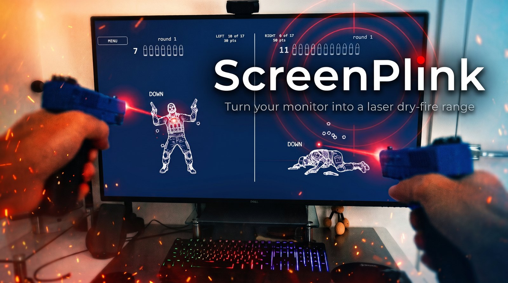
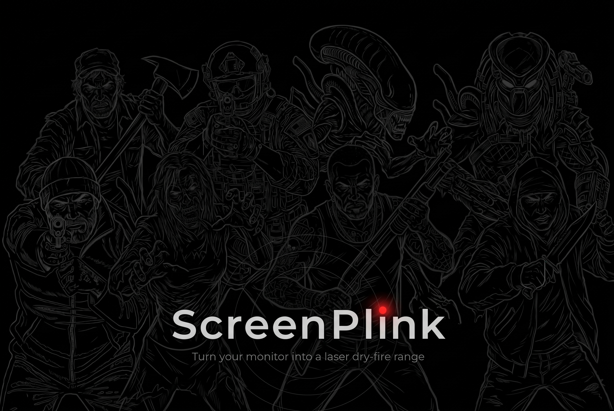

# ScreenPlink

This is a ***laser shooting game***. Your monitor is the target.

You shoot your own monitor with either a laser training pistol or with your own gun & laser bullet. A webcam watches the
monitor (instead of watching you), the app figures out which pixel you hit, punches a bullet hole there and
plays the shot. Targets fall, scores count, the gun's magazine runs dry.

Full source code included with the build. Free, offline, no account, no ads. Version 1.0 works on Windows only. Feel free to clone and make it work for Mac if you feel like it.

It is an ideal addition to a man cave, and it works anywhere you have the
hardware and can control the lighting: a games room, a basement, a bar. The
lighting is the real constraint rather than the space. You are not asked to sit
in the dark, but a room you can dim is a room this works better in.

<p align="center">
  <a href="https://youtu.be/tg2Bt8K5IE0" target="_blank" rel="noopener">
    
  </a>
</p>

<h3 align="center">
  🎬 <a href="https://youtu.be/tg2Bt8K5IE0" target="_blank" rel="noopener">Watch the trailer</a>
  &nbsp;&nbsp;&nbsp;
  🔬 <a href="https://youtu.be/pIdJhRYK-Bw" target="_blank" rel="noopener">How it actually works</a>
</h3>

<p align="center"><i>The trailer is what it is. The second one is the physics:
why the monitor has to be matte, and why an ordinary webcam is enough.</i></p>

---

## What you get

- **Nine drills.** Static targets, an escalating ball, bouncing balls, reaction,
  clear the board, pop-up figures, a held figure, a figure that walks in and back
  out, and a soldier who takes hits and drops.
- **Fifteen figures** with scoring rings printed on them, and a fall for each.
- **A seventeen-round magazine.** Every shot spends a round, hit or miss. Fire on
  empty and you get a click instead of a bang.
- **Two players on one screen**, left and right, scored separately, each with
  their own magazine and their own score. Play someone else, or take both halves
  yourself with a pistol in each hand and work your weak side. **Two lasers
  landing in the same camera frame are detected as two separate shots**, so
  firing together is not a problem.
- **Shoot the menu.** The menu is targets too, so you never need the keyboard.
- **It sets itself up without you firing a shot.** It photographs its own markers
  on the screen to learn where the screen is and which pixel is which, so
  calibration costs you no ammunition and no patience.
- **It tells you when it is ready**, in about thirty seconds, or tells you the one
  thing to fix.

📖 The [User Guide](manual/README.md) describes the gameplay exactly: every drill
and how it is scored, the magazine, two players, and every key.

## Why this exists

In Q4 2026 I went looking for a free game that would let me shoot moving targets
on my own computer monitor with my laser trainer pistols. I did not find anything
quite like that.

So I [read up on the dry-fire laser landscape][book], and worked out that it
ought to be possible, provided the monitor is matte and the camera does at least
60 frames per second. Then I built the game I wanted, to my own taste and my own
requirements.

I am sharing it in case a few other people find it useful.

## What you need

| | |
|---|---|
| **A matte monitor** | Anti-glare, not glossy, not a TV. This one is not negotiable. See the physics below |
| **A webcam** | Anything that does 60 fps. It goes *beside* the monitor, angled at it, not downrange |
| **A laser trainer** | Any visible red (650 nm) cartridge or trainer pistol. Two work at once |

### One setup, honestly

All of this was built and measured against exactly one rig: a Dell U4320Q
(42.5″ 4K, matte) watched by a Razer Kiyo Pro, shot with two LaserLyte LT-TTL
trainers. Nothing is hard-coded to any of it, and the app measures your camera
and your room rather than assuming mine. But one monitor and one webcam is one
monitor and one webcam. Your camera may report its exposure differently, your
panel may scatter the dot differently, and you may meet something I never did.

That is what [TROUBLESHOOTING.md](TROUBLESHOOTING.md) is for. It is written from
the faults this hardware actually produced, and it lists the numbers a healthy
setup gives, so you can tell how far yours is from working. If you hit
something that is not in it, open an issue: numbers from a second rig are worth
more to this project than any feature.

## Get it

You can either clone the repo to your local drive or you can just download the release, unzip it, run **`Play.cmd`**. 
`Doctor.cmd` checks your camera and writes a report.

**Or do not set it up at all: ask Claude Code to.** Unzip the release, open the
folder with [Claude Code](https://claude.com/claude-code), and ask it to set up
the app. The release ships a `CLAUDE.md` written for exactly that job, and an
`.mcp.json` so the session finds the app's own tools by itself. Nothing to
configure first. It runs the camera doctor, picks the camera that is actually
pointed at your monitor (by what each one measures, not by its name), starts the
app, reads what the app measured about your room, and tells you when to shoot or
which one physical thing is in the way.

This is how the author sets it up now. See [Asking the app what it sees](MCP.md).

From source:

```bat
python -m venv app\.venv
app\.venv\Scripts\python.exe -m pip install -r app\requirements.txt
app\scripts\Play.cmd
```

Close the game with **Escape**. Never End Task because a force-killed app can leave the webcam needing a replug.

---

## The physics, briefly

Your trainer fires about 100 ms of red light per trigger pull. At 60 frames per
second the camera gets six looks at it, which is what makes an ordinary webcam
enough: six frames is a shot, one frame is noise.

The detector does not hunt for *bright*. It hunts for *red*, meaning red minus
the stronger of green and blue. That is why the whole game is grey and dim.
Anything red on that screen is something the camera could mistake for your laser,
and anything bright underneath the dot drowns it.

The reason the panel must be matte is the same sort of thing. A matte coating
scatters the dot, so a camera off to one side can see it. Glossy glass reflects
it away instead, in a direction that changes with every shot, so no camera
placement can follow.

<p align="center">
  🔬 <b><a href="https://youtu.be/pIdJhRYK-Bw" target="_blank" rel="noopener">
  The full explanation is a short video</a></b>
</p>

## If you are building something like this

Two weeks of building this produced a long list of mistakes, and I wrote them
down as I went: **[Lessons learned](LESSONS-LEARNED.md)**. Twenty of them, each
with the measurement that caused it.

I am putting it in front of you because almost none of it is about lasers. It is
about the things that go wrong when a program has to measure the physical world
and then decide something on the strength of it:

- I chose an exposure by a number that **correlated** with what I cared about
  instead of the thing itself, and darkening the room, the single best condition
  this app can have, is what broke it.
- My whole-launch test harness **exited after its first launch and reported
  success**, for as long as it had existed. A figure I had quoted for days had
  never been measured.
- A cleanup worked for weeks **because of what happened to run after it**, and
  failed the day that stopped being true.
- One missing file raised an exception inside a paint handler, and the app spent
  days telling me to unplug a camera that was measuring sub-millimetre accuracy
  four seconds earlier.

If you are writing anything with a camera, a real-time loop, or a program that
has to diagnose its own hardware and explain itself to a human, I think you will
recognise several of these, and some of them are cheaper to read about than to
find. There is nothing personal in that file and nothing specific to my setup.

## Read more

| | |
|---|---|
| 📖 **[User Guide](manual/README.md)** | Thirteen chapters: the screen it needs, setup, the nine drills, the magazine, the score, two players and every key. PDF and EPUB included |
| 🔧 **[Troubleshooting](TROUBLESHOOTING.md)** | When the app does not work. Start at the top: the most common fault is not in this app at all |
| 🗺️ **[Project layout](PROJECT-LAYOUT.md)** | Every folder, for anyone changing the code |
| 🧭 **[Lessons learned](LESSONS-LEARNED.md)** | Twenty things this project got wrong and what each one cost. Mostly not about lasers: measuring the wrong quantity, checks that could not fail, a cleanup that only worked by accident, a note that stopped being true |
| 🤖 **[Asking the app what it sees](MCP.md)** | The app answers questions about itself while it runs, over MCP or plain HTTP: what the detector scored, what is painted, what it measured and why. Measurements, never conclusions |
| 📕 **[Laser Training for Home Shooters][book]** | A Q4 2026 book on the laser dry-fire category: the apps, the targets, the sensors, the scoring and the failure modes. Built from a few AI deep-research reports over vendor documentation and owner reports, with nothing in it bought or borrowed. It is not about this project. It is a survey of dry laser shooting that I built for myself, to understand the landscape and to check whether what I was about to build already existed in some shape or form |

## Issues and pull requests

Both are open.

Setting expectations honestly: this is one person's side project, built in two
weeks against one monitor and one webcam. There is no support commitment and no
promise about response times. What there is, is an app that measures everything
it does and writes it down, so a problem can usually be diagnosed from a file
rather than from a conversation.

**If something does not work**, the two files that answer most questions are
`app\logs\camera_lab.log` (one `GATE` line per launch, carrying the verdict,
the calibration error, the frame rate, the noise floor and the detection bar)
and the `doctor-report.txt` that `Doctor.cmd` writes. Paste those rather than
describing the symptom. [TROUBLESHOOTING.md](TROUBLESHOOTING.md) explains what
each number means and what a healthy one looks like.

**The most useful thing anyone can send is a second rig.** A different panel, a
different camera, a different room. Everything here was measured on one setup,
and the honest limit of this project is that nobody knows what the second one
does.

**For pull requests:** the full test suite ships with the release and with the
repository, needs no camera and no screen, and runs with
`app\scripts\run_tests.bat`. Please run it. And read
[LESSONS-LEARNED.md](LESSONS-LEARNED.md) first, because several of the things
that look like dead weight in this codebase are load-bearing for reasons that
cost days to find.

## Credits, and what is actually mine

The **code** is mine and is [Apache-2.0](LICENSE). The **assets are not all mine**
and do not come under that licence, so if you fork this, they travel with their
own terms rather than with mine.

| | |
|---|---|
| **Sound effects** | From [Pixabay](https://pixabay.com/sound-effects/) |
| **Images** | The startup screen, the fifteen target figures and their falls, the menu tiles and the magazine round were all generated with **Google Gemini** |
| **Spoken lines** | Generated with [ElevenLabs](https://elevenlabs.io): twenty-two lines in three voices |

The packaged release also bundles third-party libraries, two of them under the
LGPL. They are listed with their sources in
[THIRD-PARTY-NOTICES.md](THIRD-PARTY-NOTICES.md).

## Safety

This is dry-fire practice: a laser cartridge or a laser pistol, and **no
ammunition anywhere in the room**. The app cannot know what is in your hand, so
that part is yours. The trainers are 5 mW Class IIIa. They will not harm an LCD,
but do not look into the muzzle.

---

<p align="center">
  
</p>

[book]: https://github.com/vkorost/laser-dry-fire-field-guide
