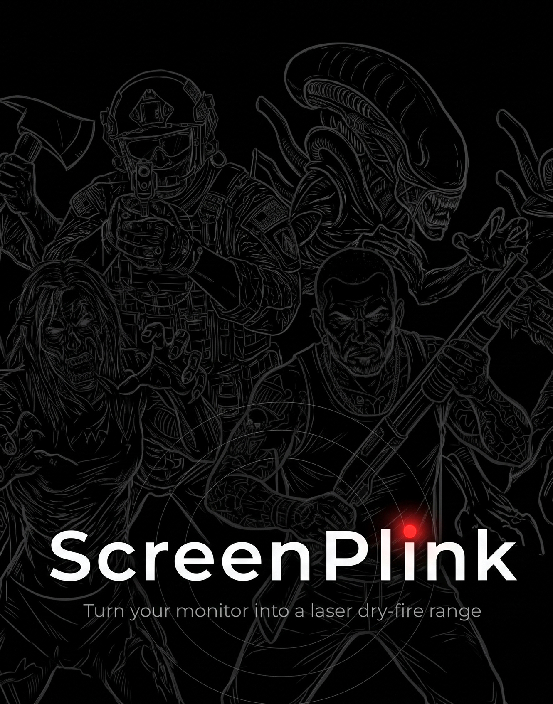

# ScreenPlink — the User Guide

Thirteen chapters on setting the app up and shooting it: what the screen has to
be, what the app measures before it lets you fire, the nine drills, the
magazine, the score, two players, and every key.

This folder is self-contained. The chapters, the screenshots they use and the
two finished formats are all here, and nothing in it needs a build step, a
script, or a file from anywhere else in the repository.

## Read it as one document

- **[PDF](./ScreenPlink_User_Guide_v01.pdf)** — 31 pages, US Letter, with a table of contents.
- **[EPUB](./ScreenPlink_User_Guide_v01.epub)** — for e-readers and phones.

## Read it a chapter at a time

**Start with chapter 1.** The screen is the one requirement that cannot be
worked around in software, and it decides whether any of the rest will work for
you: a matte, anti-glare monitor, not a glossy panel and not a television.

| | Chapter | What it covers |
|---|---|---|
| 0 | [What ScreenPlink Is](./chapters/00-what-it-is.md) | What the app does, and why every single thing on screen is dim grey |
| 1 | [The Screen It Needs](./chapters/01-the-screen-it-needs.md) | **Read this first.** Matte only, and why a glossy screen cannot be fixed in software |
| 2 | [Quick Start](./chapters/02-quick-start.md) | The three things you need, and the first run in order |
| 3 | [What the App Does Before It Lets You Shoot](./chapters/03-before-you-shoot.md) | The half minute of self-measurement at launch, and what each step is for |
| 4 | [The Menu, and Moving Between Drills](./chapters/04-the-menu.md) | The shoot-at-it menu, and the keys that bypass it |
| 5 | [The Magazine: Seventeen Rounds](./chapters/05-the-magazine.md) | Why a round is a magazine, and why a miss carries no separate penalty |
| 6 | [The Score, and the Record Book](./chapters/06-the-score.md) | Score against a perfect shooter, efficiency in points per second, and where bests are kept |
| 7 | [The Drills: One to Five](./chapters/07-drills-one-to-five.md) | Static targets, the escalating ball, bouncing balls, reaction, clear the board |
| 8 | [The Drills: Six to Nine, the Figures](./chapters/08-drills-six-to-nine.md) | The fifteen figures, their printed scoring rings, and the filmed soldier |
| 9 | [Two Players](./chapters/09-two-players.md) | One screen split, a magazine each, and how the round is won |
| 10 | [Why This Is Family Fun](./chapters/10-family-fun.md) | The case for shooting it with somebody else |
| 11 | [Every Key](./chapters/11-every-key.md) | The whole keyboard, as the app itself draws it |
| 12 | [Looking After It](./chapters/12-looking-after-it.md) | Closing it properly, what lives in the release folder, and what the common failures actually are |

## Safety

The guide describes practice with an **unloaded** firearm or a dedicated laser
training pistol. Nothing in it relaxes any rule of safe gun handling. Check and
check again that the chamber and the magazine well are empty, and that no live
ammunition is in the room.

---

## What is in this folder

```
README.md                        this page
ScreenPlink_User_Guide_v01.pdf   the whole guide, 31 pages
ScreenPlink_User_Guide_v01.epub  the whole guide, for e-readers
chapters/                        the thirteen chapters as markdown
media/                           the screenshots, and the cover
```

The chapters are the source the PDF and the EPUB are built from, so they are
the copy to read if you want to follow a link or quote a line. The two finished
formats carry the same words with a cover, a title page and page numbers.

Images are referenced as `../media/…` from inside `chapters/`, which is what
makes a chapter render correctly both on GitHub and in any markdown viewer
opened on the file itself.
