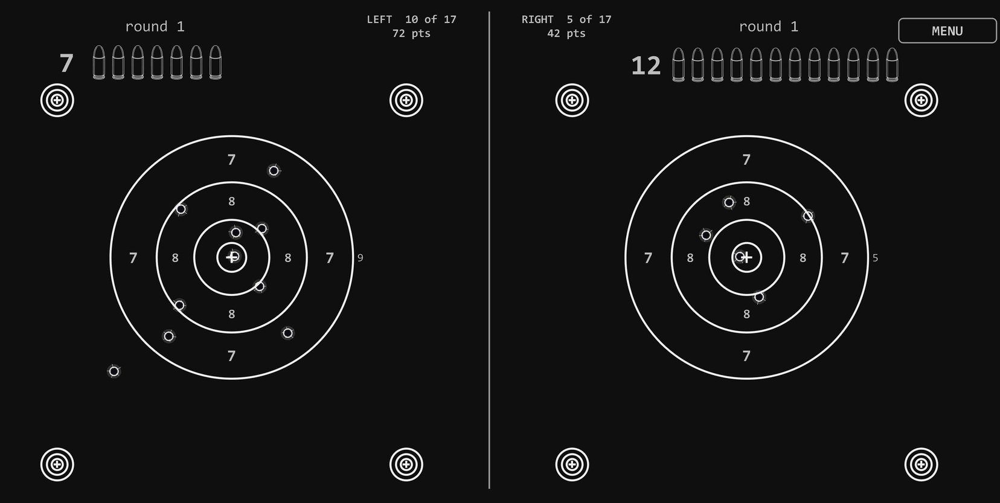

# What ScreenPlink Is

ScreenPlink turns a monitor you already own into a shooting range. The screen
shows targets. An ordinary USB webcam watches the screen. When you fire a laser
trainer pistol at it, the app works out which pixel the dot landed on, draws a
bullet hole there and plays a shot.

*Static Targets, in two-player mode. Each side has its own magazine, its own round counter and its own score.*

There is no projector, no special screen and no sensor bar. The camera does not
have to sit in front of the monitor: off to one side at an angle is normal and
fully supported, because the app measures the mapping from the camera's view to
the screen rather than assuming one.

## Why everything is grey

Nothing in this app is drawn in colour, and nothing is drawn brightly. That is
not a style decision, it is the only way the thing works.

The camera is hunting for a red dot. It scores every pixel by how much redder it
is than it is green or blue, so a red graphic anywhere on screen builds a target
that shoots itself. Early versions did exactly that: an amber warning panel and a
coloured status bar fired dozens of phantom shots in a single session.

Brightness matters for the opposite reason. A laser dot landing on a lit grey
area loses that grey from its score, one unit for one unit, because the red is
already saturated and the green and blue underneath it are not. A target filled
with bright grey is a target that eats the shots aimed at it.

So every target, every number and every box is neutral grey on black, and the
brightest grey the app will draw is taken from the darkest of the target drawings
on disk. Add a darker drawing and the whole interface dims to match it.

## Sizes, not pixels

Nothing on screen is sized in pixels. Every target, every piece of text and every
box is a fraction of the screen, so the same drill plays the same way on a
24-inch monitor as on a 43-inch one, and a 4K screen is not four times harder
than a 1080p one for no reason.

Size is not the constraint. **The surface is**, and it is the one requirement in
the app that nothing else can make up for, so it has the next chapter to itself.
