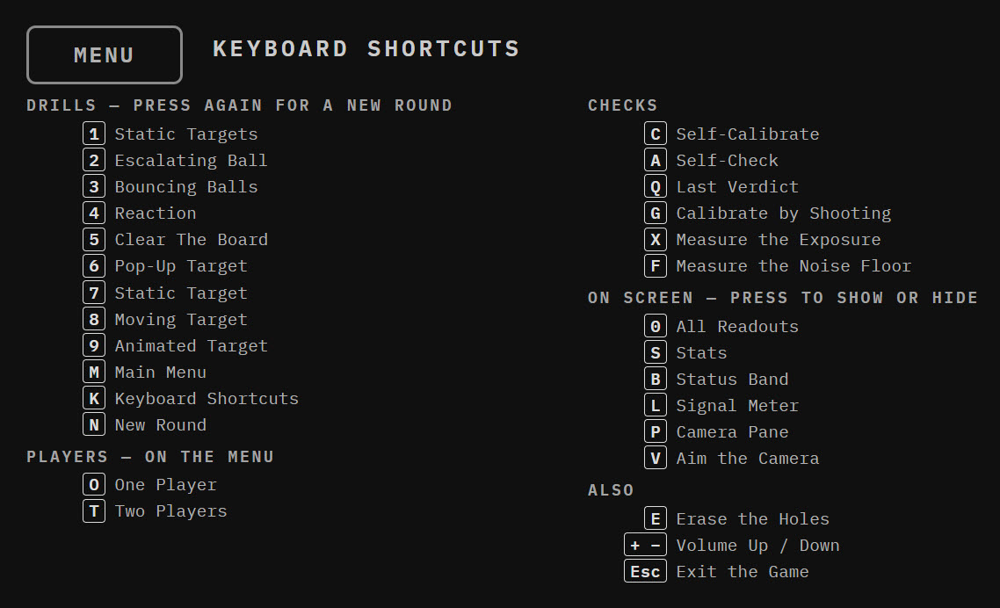

# Every Key

Press **K** at any time and the app shows this screen itself.

*The Keyboard Shortcuts screen, as the app draws it.*

The drill rows on that screen are read from the app's own list of drills, using
each drill's own name, so a drill added in a later version appears there by
itself and a renamed one cannot be mis-described. It exists because the key list
it replaced was typed by hand and spent three days advertising a drill that had
been removed.

| Key | Drill |
|----------------|--------------------------------------------------------|
| **1** | Static Targets |
| **2** | Escalating Ball |
| **3** | Bouncing Balls |
| **4** | Reaction |
| **5** | Clear The Board |
| **6** | Pop-Up Target |
| **7** | Static Target |
| **8** | Moving Target |
| **9** | Animated Target |
| **M** | Main Menu |
| **K** | Keyboard Shortcuts |
| **N** | New round |

Pressing a drill's own key again starts a new round of it.

| Key | On the menu |
|----------------------|--------------------------------------------------|
| **O** | One player |
| **T** | Two players |

| Key | Checks |
|-----------|-------------------------------------------------------------|
| **C** | Self-calibrate |
| **A** | Self-check |
| **Q** | Show the last verdict |
| **G** | Calibrate by shooting a grid |
| **X** | Measure the exposure |
| **F** | Measure the noise floor |

| Key | Show or hide |
|------------|------------------------------------------------------------|
| **0** | All the readouts at once |
| **S** | Stats |
| **B** | Status band |
| **L** | Signal meter |
| **P** | Camera pane |
| **V** | Aim the camera |

| Key | Also |
|---------------------------|---------------------------------------------|
| **E** | Erase the holes |
| **+** **-** | Volume up and down |
| **PgUp** **PgDn** | Target speed, faster and slower |
| **Esc** | Exit the game |

**Page Up and Page Down change how fast the targets move**, and the app
remembers the setting for each drill separately. Speed up Bouncing Balls and
Moving Target stays exactly as you left it. The speed is saved, so the drill
starts at your setting the next time you launch the app rather than reverting to
the one it shipped with.

Three drills move and therefore have a speed: Escalating Ball, Bouncing Balls
and Moving Target. Press the keys anywhere else and the screen tells you that
drill has no speed, rather than appearing to do something and doing nothing.

The setting is a multiplier on the drill's own curve, from a quarter speed to
three times, and 100 per cent is always on the way back. The drill's own ceiling
still applies on top of it: a ball cannot be driven past the speed at which it
travels more than its own width while the laser is lit, because past that point
a clean hit starts reading as a miss and the fault would look like the camera's.

The shortcuts screen claims no keys of its own. From it, pressing 1 starts drill
1 and C calibrates, exactly as if you were on a drill. A shot fired at it draws
its hole and scores nothing, so the hit rate is not deflated by shots at a help
screen.
